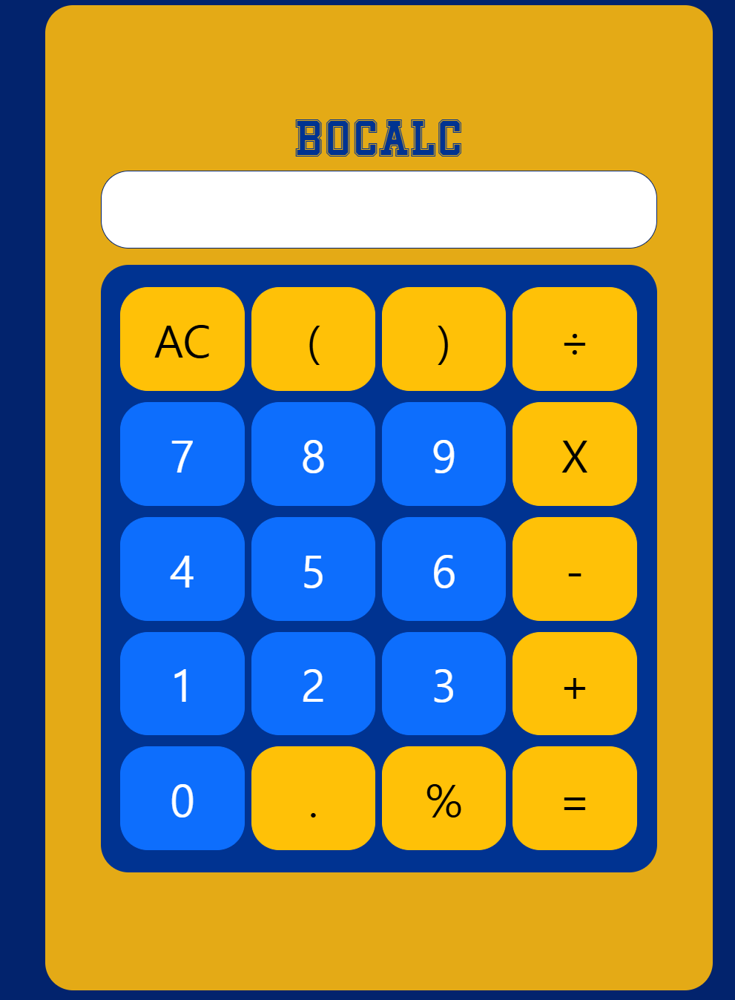
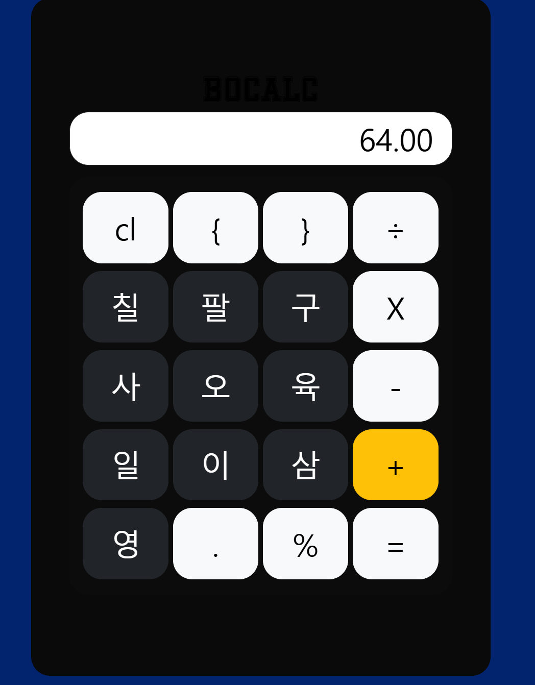

Installation: 설치·실행 방법 및 실행 화면

    cd react-calculator
    npm run dev

README.md & Weekly Review
Project Information: 프로젝트 소개, 선택 이유, 원본 GitHub URL 및 라이선스

    선정한 프로젝트: 계산기를 웹에서 나타내는 프로젝트

    선정 이유는 README.md, package.json 포함된 프로젝트를 찾다가 모든걸 만족하는 프로젝트가 이 프로젝트였기 때문에 선정하게 되음.

Project Structure: 주요 파일 2~3개의 역할

    index.html:기존에 사용하던 틀 역할을 함.
에 App.jsx를 담을 그릇을 준비함
    main.jsx:App.jsx을 
에 담을 수 있도록 도와줌
    App.jsx:실질적으로 우리가 보는 내용을 담고 있음

React Component: 주요 컴포넌트 1~2개의 역할

    ButtonContainer.jsx:계산기에 보이는 정보를 계싼기의 흐름대로 행과 열로 나열해주고 각 기호와 숫자 버튼과 값들을 연결해줌

Code Analysis: 코드 1개(약 5~15줄)를 선택하여 동작 원리 설명

    import { Container, Col, Row } from 'react-bootstrap'는
    low와 col은 부트스트랩에서 지원하는 함수fh 외부 페키지로 사용하면
    행과 열을 구분해주고 간격을 일정하게 해줌 

    function ButtonCustom({ variant, value, onClick }) {
    return (
        <Button type='button' variant={variant} className='fs-1'    onClick={onClick}>{value}</Button>
        );
    }
    을 통해서  ButtonCustom만 쓰면 색상과 한번 클릭하면 어떤 함수가 발동할지 그리고 그 버튼에 들어갈 값만 넣으면 일정한 폰트의  입력한 값이 들어가는 버튼 알아서 생성해줌

    죽
    <Container className='buttonContainer'>
      <Row> 1번행을 생성
        <Col><ButtonCustom variant={'warning'} value={'AC'} onClick={() => clearClick()} /></Col> 
        :1번행에 1번열에 색이 노란색 이름은 ac 한번 클릭하면 clearClick()이라는 함수를 실행하라는 의미가 도미
        <Col><ButtonCustom variant={'warning'} value={'('} onClick={() => buttonClick('(')} /></Col>
        :1번행에 2번열에 색이 노란색 값은 ac 한번 클릭하면 clearClick()이라는 함수를 실행하라는 의미가 됨
        <Col><ButtonCustom variant={'warning'} value={')'} onClick={() => buttonClick(')')} /></Col>
        :1번행에 3번열에 색이 노란색 값은 ) 한번 클릭하면 clearClick()이라는 함수를 실행하라는 의미가 됨
        <Col><ButtonCustom variant={'warning'} value={'÷'} onClick={() => buttonClick('/')} /></Col>
        :1번행에 4번열에 색이 노란색 값은 ÷ 한번 클릭하면 clearClick()이라는 함수를 실행하라는 의미가 됨
      </Row>

     뒤에 부분도 위와 같은 로직으로 작동함(행과 열 색상과 버튼의 값만 달라짐)

수정 파일명과 변경 전 결과

수정 파일명과 변경 후 결과

Deployment: 실제 접근 가능한 Vercel URL

   원본 urlhttps://github.com/alexiscirmi/react-calculator

새롭게 배운 내용 3가지

    1.index.html:기존에 사용하던 틀 역할을 함.
에 App.
    2.main.jsx:App.jsx을 
에 담을 수 있도록 도와줌
    3. App.jsx:실질적으로 우리가 보는 내용을 담고 있음

어려웠던 점과 해결 방법
    가장 어려웠던 부분은 점은 일단 적당한 프로젝트를 찾는 부분이 가장 어려웠으며 ai의 도움을 받아 과제의 키워드와 ai의 조언을 섞어서 적당한 프로젝트를 찾았음

AI 활용 내용 및 느낀 점
    1.프로젝트를 찾기 위한 키워드를 조언받음
    2. import { Container, Col, Row } from 'react-bootstrap'이 뭔지 
    몰라서 혹시 부트스트랩을 이용해서 사용한것인지 물어봄
    3.README에 사진을 넣어본적이없어서 어떻게 넣는거지 물어봄
    4git clone을 사용하여 과제리포에 옮겼는데 404에러가 발생하여 이를 해결하고자 ai를 사용

    느낀점
    이번 프로젝트는 한번에 너무 많은 내용이 복합적으로 작용해서 상당히 난이도가 느꼈졌다
    적당한 프로젝트를 찾는것도 상당히 어려웠다.
    git clone을 할 때 clone을 한 파일에 .git이라는 파일이 존재해서 문제가 발생하였느데 이를 해결하는것이 너무 힘들었다.(원인은 아직 잘 모르겠습니다.)4
    컴포넌트의 내용들이 import와 export가 유기적으로 연결되어서 코드를 읽는것이 상당히 힘들었다.

<!--
fork:복제
pr:pull reqwst

jsx

class >>> className

funcion a(){}>>funcion a = ()=>{}

주석 {"<!---->"}

-->